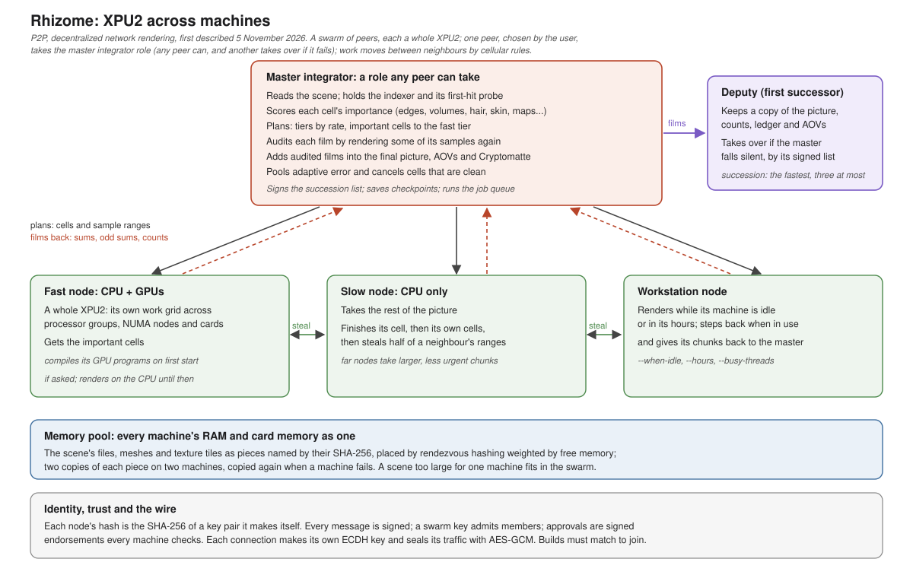

# Rhizome: XPU2 across machines

**Rhizome** is P2P, decentralized network rendering: one picture rendered on many machines, with no render server and
no fixed manager. It is a swarm of peers: every machine that can, contributes. Each one finds the others, takes work
and passes it on by the same cellular rules [XPU2](https://github.com/Pbaroque20/xpu2-foundation/tree/xpu2-async)
uses between a processor and a graphics card. Pieces of the scene live across the peers' memory, and work moves
between neighbours directly.

One peer, chosen by the user, takes the role of **master integrator** for a job. It holds the scene's indexer, sends
the cells out, adds what comes back into the final picture and audits it. It is a role, not a server: any peer can
hold it, and if the master falls silent the next peer in its signed succession list takes over.

Rhizome and XPU2 are designed by Raphael Tobar and implemented with AI assistance. The design was first described on
5 November 2026. Not affiliated with or endorsed by DreamWorks Animation; MoonRay and OpenMoonRay are DreamWorks
Animation's.

Rhizome is released under the [MIT license](/LICENSE), as XPU2 is.



## Architecture

Rhizome is the outer tier of XPU2's multi-device extension. Inside a machine, XPU2 already shares a frame between
processor groups, NUMA nodes and graphics cards. Rhizome adds machines above them. A machine is a node of the swarm
as a NUMA node is a node of the machine: the work it is given is near it, and the farther it is, the larger and less
urgent its share. Every node is a whole XPU2 with its own work grid.

- **Nodes and their hashes.** Each node makes a key pair the first time it runs. Its hash, the SHA-256 of its public
  key, is its identity in the swarm. Every message is signed, so every sample in the picture is known by the node
  that made it.
- **The swarm.** A node needs the address of one member, or finds the swarm by discovery on the local network. Where
  a broadcast does not reach, behind a router or over a VPN, the master probes address ranges one address at a time
  and remembers every machine it has reached, so a node found once is found again. One command adds the firewall
  rule a machine needs. Members are kept by heartbeats, and the distance between two nodes is their round-trip time.
  Nodes join and leave at any time; a node that leaves has its unreturned work given out again.
- **The master integrator.** The only node that reads the scene. Before a frame its indexer probes the picture and
  scores each cell's importance: edges, many materials or lights, detailed maps, volumes, hair, subsurface. It sorts
  the nodes into tiers by rate and gives the important cells to the fast tier and the rest to the slow tier.
- **Cells, ownership and stealing.** The picture is cut into cells, each with one owner at a time, so no sample is
  rendered twice. A node finishes its cell, then its own cells, then asks a neighbour for half of its remaining work.
  Near nodes take small chunks, far ones larger ones. From one frame to the next, a cell goes back to the machine
  that rendered most of it, where the scene data its pixels read is already fetched and its caches are warm.
- **The audit.** Every XPU2 sample is defined by its identity, so any machine renders it to the same value. The master
  renders again a few samples of each contribution, chosen by a seed the nodes do not know. A contribution that does
  not match is thrown away, and its node is refused for the rest of the session.
- **One film.** Each node sends back its sums, odd sums and sample counts. The master adds them as a graphics card's
  film is added into the first card's, merges AOVs and Cryptomatte, pools the error for adaptive sampling across
  machines and writes the scene's outputs once.
- **Memory pool.** Every machine's RAM and graphics card memory form one pool. The scene's files, meshes and textures
  are pieces named by their SHA-256, each kept on two machines and copied again when one fails. A node does not copy
  the scene's textures whole: it fetches each piece from the pool the first time its render reads it, so texture data
  a machine's cells never see never crosses the network.
- **Master failover.** The master signs a succession list, the fastest nodes first. The first successor, the deputy,
  keeps a copy of the picture and its ledger. If the master falls silent, the deputy takes over and finishes the frame.
- **Trust and the wire.** A swarm key admits members. Approvals are signed endorsements every machine can check, and
  a revoked node is refused. Each connection makes its own key exchange (ECDH) and seals its traffic with AES-GCM, so
  scene files cross the network unread. Machines must run the same XPU2 build and GPU programs to join.
- **Jobs.** Frame ranges, a job queue folder, each frame's changes sent alone, and checkpoints so a job is taken up
  again after every machine has stopped.
- **Workstations.** A node can render only while its machine is idle or in set hours, and gives its work back when
  someone sits down at it.

## Where it stands

Parts 1 to 18 of the plan are built and tested on one Windows machine, with a master and several nodes as separate
processes. Our test scenes render as one machine renders them (block error 0), stills and animated jobs alike, even
with the master killed part way or every machine stopped and started again. They include a Modo scene exported to
MoonRay and a VDB cloud. A node renders a scene's textures (121 MB in the test) straight from the swarm's memory
with the same picture, and with the camera moving, 35 of a frame's 49 cells stay with the machine that rendered them
the frame before. With broadcast switched off, a master found two nodes by sweeping their addresses, then by the
remembered addresses alone. Textured lights are read from the swarm's memory too, and pass the master's audit.

Still to do: a test on two real machines, and macOS, with the platform roadmap. The full design and the plan, part
by part, are in [RHIZOME.md](/xpu2/interactive/RHIZOME.md).

## In Modo

Rhizome is released in [MoonRay for Modo 0.5.4](https://github.com/Pbaroque20/MoonRayForModo/releases/tag/v0.5.4)
(11 November 2026), under MoonRay > Rhizome: Decentralized Rendering. One window renders this frame or a range of
frames on the swarm, makes this machine a node, shows every machine at work, approves new machines and adds the
Windows Firewall rule. Install the same release on every machine that takes part.


### Setting it up

**On every machine, once:** install the same release, and run Compile XPU2 Shaders (System > Preferences > MoonRay >
XPU2 > Device Management). In the Rhizome window, type the **Rhizome key** at the top: any words, the same on every
machine; it never leaves the machine. On **Approvals and Firewall**, click **Add Rule...** and accept Windows'
administrator prompt (the rule covers private and domain networks, not public ones).

**On each machine that helps:** on **This Machine as a Node**, click **Start Node**. The node keeps running after
Modo is closed, until **Stop Node**. On a workstation it can render only when the keyboard and mouse have been idle,
only between set hours, or step back while someone works.

**On the machine that renders:** open the scene, choose **This frame** or **Frames** and the **Pictures in** folder on
the **Render** page, and click **Render on the Swarm**. The scene is exported, the nodes found render their shares,
and the pictures come out as `<scene>.exr` or `<scene>.####.exr`. **Stop** ends it; started again on the same frames,
it picks up where it stopped. The other machines need neither the scene nor its textures.

**When nodes are not found:** behind a router or over a VPN, give their addresses under **Nodes by address**
(`host:47100`) or a range under **Look for nodes in** (`10.8.0.0/24`, or `*`); a machine found once is remembered.
The ports are 47100 and 47110 over TCP, and 47101 to 47104 over UDP. To keep unknown machines out, tick **Only
machines approved** and approve each new one on **Approvals and Firewall**.

The full steps are in MoonRay for Modo's
[installation guide](https://github.com/Pbaroque20/MoonRayForModo/blob/MoonLightIPR/docs/INSTALLATION.md#rendering-across-machines-with-rhizome).

## Running it

```
moonray_xpu2 rhizome id                                       this machine's hash
moonray_xpu2 rhizome node --key <swarm key>                   a node: waits for a master and renders its jobs
moonray_xpu2 rhizome master -in scene.rdla -out beauty.pfm --key <swarm key>
moonray_xpu2 rhizome submit --queue jobs -in shot.####.rdla -out beauty.####.pfm --frames 1-24
moonray_xpu2 rhizome status --watch                           every machine's role, progress and pool share
moonray_xpu2 rhizome firewall                                 the firewall rule a machine needs, added once
```

Each verb has `--help`; `status --json` gives the swarm's state to a script. What a program or script can rely on
(every option, a machine's folder, `status.json`, the job files, the ports) is in
[RHIZOME_API.md](/xpu2/interactive/RHIZOME_API.md). Building XPU2 is in the [engineer manual](/xpu2/manual/README.md#14-building-and-running).
The unit checks are `xpu2/interactive/rhizome_test.cc` and `rhizome_trust_test.cc`.

## Branches

- `xpu2-network` (this branch): Rhizome, on top of XPU2's core.
- [`xpu2-async`](https://github.com/Pbaroque20/xpu2-foundation/tree/xpu2-async): XPU2's core and its documents.
- `xpu-plus`: XPU+, the earlier synchronous approach.

The Modo window and the kit belong to [MoonRay for Modo](https://github.com/Pbaroque20/MoonRayForModo), branch
`MoonLightIPR`, which carries Rhizome with XPU2.
