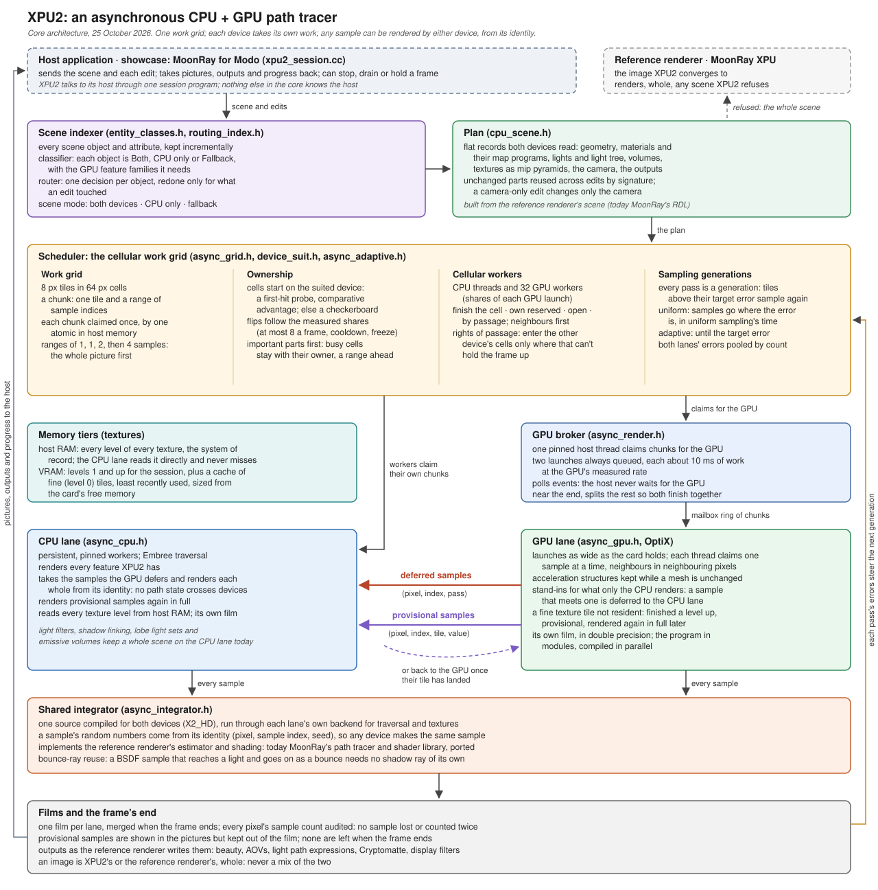

# xpu2-foundation

*Cellular automata scheduling in XPU2; both CPU/GPU contribute to the image without waiting. Footage Provided by Pixelwerk.*

**XPU2** is an asynchronous CPU + GPU Monte Carlo path tracer. The CPU and GPU render collaborate on same image at once: each
claims its own work, neither waits for the other, and any sample can be rendered on either device with the same
result.

XPU2 is designed by Raphael Tobar, implemented with AI-assistance. Not affiliated with or endorsed by DreamWorks
Animation; MoonRay and OpenMoonRay are DreamWorks Animation's. XPU2 is released under the [MIT license](/LICENSE).

The mantra for XPU2 is: "Use your silicon!"

## Core ideas

- **Samples are defined by identity.** A sample is a pixel, a sample index and a frame seed, and its random numbers
  derive from those alone. Either device produces the same result, so work moves between them freely.
- **One integrator.** The path tracer is written once and compiled for both the CPU and the GPU.
- **Cellular work grid.** The image is divided into cells, each owned by a device. Workers on both devices move
  between cells by local rules, and every chunk of work is claimed exactly once.
- **No waiting.** A broker thread keeps two GPU launches queued, sized from the GPU's measured rate. The host polls
  the GPU and never blocks on it.
- **Work goes where it runs best.** An indexer classifies each scene object by the devices that can render it. Cells
  start on the better-suited device, and a GPU sample that hits a CPU-only feature is handed to the CPU.
- **Motion on both devices.** Moving meshes, subdivision surfaces, instances, curves, points, volume bounds and any
  number of moving lights render on the GPU as on the CPU, traced at each sample's time. Test scenes that used to send
  those samples to the CPU finished 2.6 to 8.5 times sooner; a scene with nothing moving costs the GPU about 2 to 3%.
  A deforming subdivision surface is tessellated once over its time steps, so adaptive tessellation and instanced
  deforming prototypes render too.
- **Volumes on both devices.** VDB clouds and fire, and mapped and glowing volumes, are marched on the GPU as on the
  CPU, the volumes' map programs run at each sample point. A march resumes from checkpoints instead of starting
  again, and a ray finds every volume it crosses in one traversal. On an RTX 3090 a VDB cloud went from 88 to 57
  seconds and a glowing mapped volume from 37 to 27.5, every picture bit-identical. Fire written as a single-value
  temperature or flames grid glows too.
- **Lean card memory.** The GPU's stack is sized from the program's real call chains and from what the scene contains,
  and each thread's scratch from what the scene uses. A launch is as wide as the card's cores can hold at once, and
  narrower only when the card is short of memory. On an RTX 3090 a simple scene went from 10.9 GB of the card to 4.5 GB
  at the same speed and with the same picture, so smaller cards can render. The parked-sample queue and the subsurface
  stack are made only for scenes that use them, and the texture cache grows as tiles are read.
- **Tiered texture memory.** Host RAM holds the coarse mip levels and the fine tiles read so far, which are decoded on
  demand and let go under memory pressure. VRAM holds the coarse levels and a cache of fine tiles. A GPU sample that
  misses a fine tile shades from a coarser level and is re-rendered in full before the frame ends. A scene that does
  not fit has its textures compressed (BC6H), then made smaller, and the preview says so. Texels are kept as half
  floats, grey maps in one channel and flat tiles as one value, so textures take about a third of the memory.
- **Sampling generations.** One sampler handles both uniform and adaptive sampling, spending samples where the error
  is highest. A frame runs for as long as uniform sampling would take, or to an exact sample count.
- **Audited results.** Each device keeps its own film. When a frame ends the films merge and every pixel's sample
  count is checked.
- **Every device in the machine.** Extra graphics cards follow the first, each with its own scene and film, taking
  cells from the same grid at their own rate. CPU workers span every Windows processor group. Realtime denoising goes
  to the first card that can run OptiX's denoiser, then to Open Image Denoise on the CPU. Each card and processor
  group can be switched off (`--list-devices` lists them).
- **NUMA-aware.** Workers are placed a share on each NUMA node, each card is fed and its texture tiles decoded on the
  node nearest it, and decoded tiles live in their node's memory. A node short of memory moves its oldest tiles to
  another node before letting any go: a hop across the sockets instead of a decode from disk. A simulation app tests
  cards, groups, nodes and denoiser hand-offs on one card.
- **Across machines: Rhizome.** P2P, decentralized network rendering: a swarm of peers, each a whole XPU2, with no
  render server. One peer takes the master integrator role for a job (any peer can, and the next takes over if it
  fails), work moves between neighbours by the same cellular rules, and every machine's RAM and card memory form one
  pool. A node fetches texture data from the pool only as its render reads it, and a cell goes back to the machine
  that rendered it the frame before, where that data already is. Its architecture and state are on the [`xpu2-network`](https://github.com/Pbaroque20/xpu2-foundation/tree/xpu2-network)
  branch, also MIT.

## Reference renderer: MoonRay

XPU2 currently implements [MoonRay](https://openmoonray.org/). MoonRay's path tracer and shader library (lights,
BSDFs, materials, maps, volumes, subsurface, hair, cameras, outputs) are ported to XPU2's integrator, so XPU2's images
converge to MoonRay's. Every port is checked against MoonRay renders, and scenes XPU2 can't render yet go to MoonRay
XPU. [Feature progress](/xpu2/interactive/FEATURE_PROGRESS.md) lists each feature and its check.

## Showcase: MoonRay for Modo

XPU2 renders previews in [MoonRay for Modo](https://www.github.com/pbaroque20/moonrayformodo/) on real production scenes, as part of the standard kit since 0.5, a
pre-production release. Measured on an RTX 3090 and an i7-4930K (6 cores, 12 threads):

| Scene | XPU2 (CPU + GPU) | MoonRay | Image vs MoonRay |
|---|---|---|---|
| Dragon from Modo, no HDRI, 1280×720, 16 samples/pixel | 9.1 s | 46.2 s (XPU) | mean ratio 1.002 |
| Polygon test scene, 360×200, 1,024 samples/pixel | 12.2 s | 122.8 s (XPU) | block error 0.0006 |
| Dose, 640×480, 64 samples/pixel, kit Source Overrides on | 9.5 s | 43 s (vector) | mean ratio 1.0006 |
| 9 Spheres, 640×480, 64 samples/pixel, kit Source Overrides on | 64 s | 176 s (vector) | mean ratio 0.9997 |
| Interior, 512×340, 64 samples/pixel | 51 s | 193 s (vector) | mean ratio 1.0003 |
| Material fixtures, first 10 of the final benchmark, 64 samples/pixel | 86–92% less time | | all pass |

Test conditions are in the [kit history](/xpu2/interactive/KIT_ROADMAP.md) and the
[indexer notes](/xpu2/interactive/INDEXER.md) (sections 14 and 15).

## Start here

| Topic | Read |
|---|---|
| How XPU2 works, with the files behind each part | [Engineer manual](/xpu2/manual/README.md) |
| The core in depth | [Asynchronous renderer](/xpu2/interactive/ASYNC.md), [indexer and scheduling](/xpu2/interactive/INDEXER.md) |
| The MoonRay port | [Path tracer and shaders](/xpu2/interactive/PATH_TRACER.md), [feature progress](/xpu2/interactive/FEATURE_PROGRESS.md) |
| Running XPU2 in Modo | [Manual: XPU2 in MoonRay for Modo](/xpu2/manual/README.md#13-xpu2-in-moonray-for-modo), [tools](/xpu2/tools/README.md) |
| Building | [Manual: building and running](/xpu2/manual/README.md#14-building-and-running) |

## Repository layout

| Layer | Location |
|---|---|
| Core | `xpu2/interactive/`: work grid, broker, CPU and GPU lanes, integrator framework, sampling, texture tiers, indexer |
| MoonRay port | `xpu2/interactive/`: plan builder for MoonRay's RDL scenes, and the shading library (`shade_*.h`, `light_*.h`, `camera_core.h`, `volume_*.h`, `aov_*.h`) |
| MoonRay for Modo host | `xpu2/interactive/xpu2_session.cc`, `xpu2/tools/` (headless Modo tools), and the MoonRay for Modo tree (`native-port/`, `kit/`, ...) |
| Documentation | `xpu2/manual/` |
| History | `xpu2/*.md`, `xpu2/*.cc`: the first attempt (the October 16 bridge experiments) |

The core and the MoonRay port currently share a folder. The manual's file map assigns each file to its layer.

## Branches

- `MoonLightIPR`, in MoonRay for Modo: where XPU2 is developed, with its host.
- `xpu2-async` (this branch): XPU2's core and its documents, brought up to date from `MoonLightIPR`. Its kit stops at the 0.5 release.
- [`xpu2-network`](https://github.com/Pbaroque20/xpu2-foundation/tree/xpu2-network): Rhizome, XPU2 across machines
  (P2P, decentralized network rendering), on top of this core.
- `xpu-plus`: XPU+, the earlier synchronous approach (19–20 October 2026). It speeds up MoonRay XPU's own pipeline with
  exact savings that keep images identical, rather than replacing it. Kept for its measurements and techniques.
